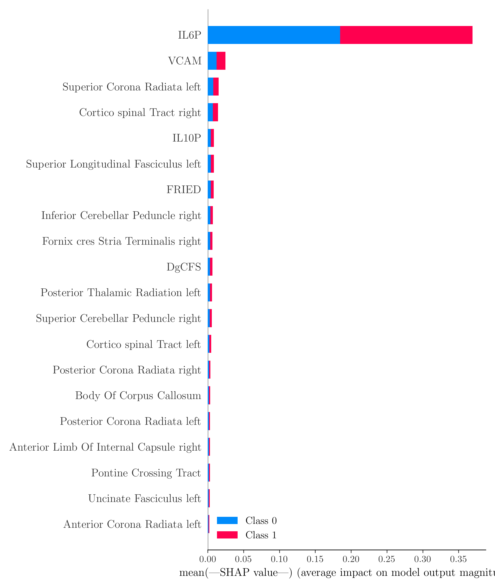

# Interpretable Multimodal Learning of Postoperative Neuroinflammatory States

This repository contains the implementation of an interpretable multimodal pattern recognition framework for discriminating preoperative and postoperative neuroinflammatory states using heterogeneous biomedical data.

The framework integrates inflammatory biomarkers and diffusion MRI–derived microstructural features within a rigorously validated machine learning pipeline, emphasizing model interpretability and robustness under limited sample size conditions.

---

## Overview

The proposed system combines:
- Multimodal tabular feature integration
- Nested cross-validation for unbiased performance estimation
- Model-driven feature selection
- Explainable machine learning using SHAP

A Random Forest classifier is used as the core pattern recognition model due to its robustness in high-dimensional feature spaces and its suitability for post-hoc interpretability.

---

## Model Interpretability

Global feature attribution was assessed using SHapley Additive exPlanations (SHAP).  
The figure below illustrates the mean absolute SHAP values across classes, highlighting the dominant contribution of postoperative IL-6 and the complementary role of diffusion MRI features.



---

## Repository Contents

- `anestesia_ML.csv` — Multimodal database in CSV file
- `anestesia_ML.xlsx` — Multimodal database in XLS file
- `ML_strategy.py` — Python script for Interpretable Multimodal Learning of Postoperative Neuroinflammatory States
- `statistical_strategy.py` — Python script for Statistical Analysis Pipeline for Multimodal Neuroinflammatory Data
---

## Requirements

The code was developed and tested using Python 3.12.  
Main dependencies include:

- numpy
- pandas
- scikit-learn
- shap
- matplotlib
- seaborn
- nibabel (if MRI preprocessing is included)


---
## How to Run

1. Clone the repository:
```bash
git clone https://github.com/pamelaFranco/interpretable-multimodal-neuroinflammation
cd interpretable-multimodal-neuroinflammation
```

2. Install dependencies:
```bash
pip install -r requirements.txt
```

3. Run the pipeline:
```bash
python ML_strategy.py
```

---
## Publications & Presentations

This repository is part of ongoing work presented at:

- *16th International Conference on Pattern Recognition Systems*, ICPRS-2026

---

## Authors

**Cristian Montalba, B.Sc.**  
iHEALTH – Millennium Institute for Intelligent Healthcare Engineering, 
Biomedical Imaging Center, and Radiology Department, School of Medicine,
Pontificia Universidad Católica de Chile, Santiago, Chile
[ORCID](https://orcid.org/0000-0003-3370-0233)

**Pamela Franco Leiva, Ph.D.**  
Energy Transformation Center,
Universidad Andrés Bello, Santiago Chile  
pamela.franco@unab.cl  
[ORCID](https://orcid.org/0000-0001-7629-3653)

**Victor Contreras, MSN, RN.**  
Division of Anesthesiology, School of Medicine  
Pontificia Universidad Católica de Chile, Santiago Chile 
[ORCID](https://orcid.org/0000-0002-6081-0430)

**Karen Azagra, B.Sc.**  
Division of Anesthesiology, School of Medicine  
Pontificia Universidad Católica de Chile, Santiago Chile    


**Luis I. Cortinez, MD.** *(Corresponding author)*  
Division of Anesthesiology, School of Medicine  
Pontificia Universidad Católica de Chile, Santiago Chile 
icortinez@gmail.com
[ORCID](https://orcid.org/0000-0001-8544-8768)   


---

## License

MIT License

---